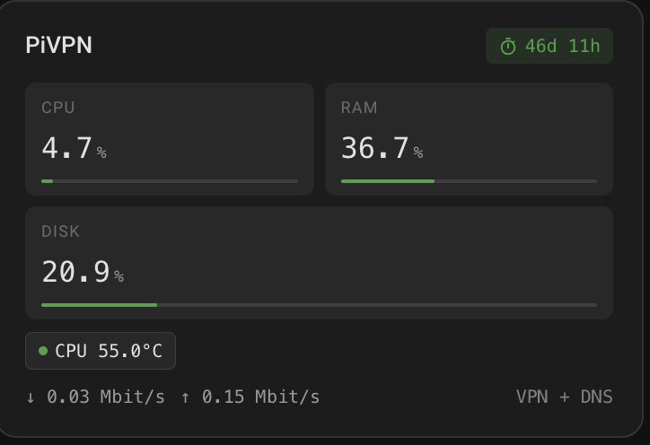
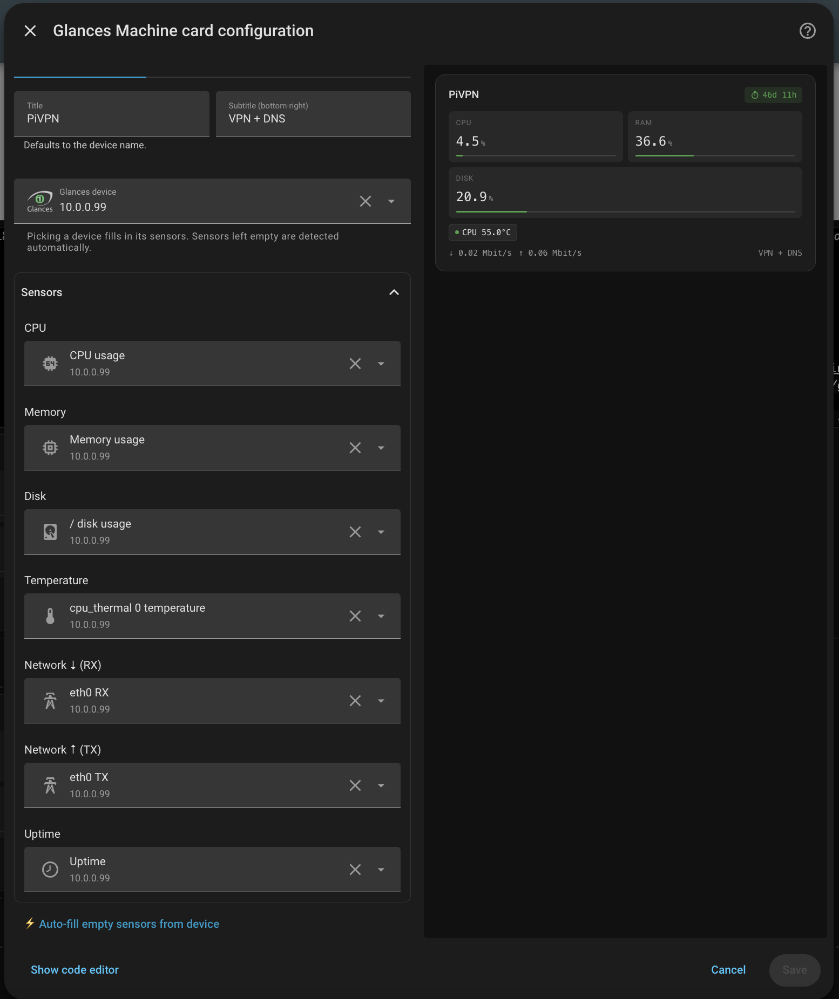

# Home Assistant Glances Machine Card

[English](README.md) · [Español](README.es.md) · [Français](README.fr.md) · **Deutsch** · [Português](README.pt.md)

Eine kompakte, ansprechende [Lovelace](https://www.home-assistant.io/dashboards/)-Karte für Home Assistant, die die Vitalwerte jedes von der [Glances-Integration](https://www.home-assistant.io/integrations/glances/) überwachten Geräts auf einen Blick anzeigt – CPU, RAM, Festplatte, Temperatur, Netzwerk und Laufzeit.

Richte sie auf ein Gerät und sie erledigt den Rest. Kein YAML-Gefummel, keine Suche nach Entitäts-IDs.

> **Basiert auf der offiziellen Integration.** Diese Karte liest die Entitäten, die von der offiziellen [Glances-Integration](https://www.home-assistant.io/integrations/glances) von Home Assistant erstellt werden – es sind weder ein zusätzliches Add-on noch eine benutzerdefinierte Integration nötig. Richte zuerst diese Integration ein.



### Screenshots

**Kartenauswahl** — so erscheint die Karte beim Hinzufügen zu einem Dashboard:


*Eintrag in der Kartenauswahl: „Glances Machine Card“ — eine Diagnosekarte für ein von Glances überwachtes Gerät. Wähle Gerät und Sensoren direkt im Editor.*

**Visueller Editor** — wähle ein Glances-Gerät und seine Sensoren werden automatisch ausgefüllt:



---

## Funktionen

- **Geräteauswahl** — der visuelle Editor listet deine Glances-Geräte unter ihrem Namen in Home Assistant auf. Wähle einfach eines aus einem Dropdown.
- **Automatische Sensorerkennung** — die Auswahl eines Geräts füllt CPU, RAM, Festplatte, Temperatur, Netzwerk und Laufzeit aus. Glances-Sensoren werden anhand der internen Schlüssel der Integration erkannt, nicht durch Raten anhand von Namen. So wird die CPU-*Auslastung* (nicht die Durchschnittslast), deine echte Netzwerkkarte (nicht Loopback oder Docker-Bridges) und das Root-Dateisystem gewählt.
- **Eingegrenzte Entitätsauswahl** — jedes Sensorfeld ist eine native Home-Assistant-Entitätsauswahl, beschränkt auf die Sensoren des ausgewählten Geräts.
- **Vollständiger UI-Editor** — kein YAML erforderlich. Er basiert auf den Standard-Formularkomponenten von Home Assistant, ohne externe Downloads, und funktioniert daher auch bei Offline-Installationen.
- **Intelligente Balken & Farben** — CPU, RAM und Festplatte werden als schmale Fortschrittsbalken dargestellt, die sich Bernstein und dann rot färben, wenn sie sich ihren Grenzwerten nähern – in den Erfolgs-/Warn-/Fehlerfarben deines Themes.
- **Temperatur-Chip** — ein farbiger Punkt warnt, wenn deine CPU heißläuft, in °C oder °F.
- **Netzwerkdurchsatz** — Download/Upload verwenden die Einheit, die du für den Sensor in Home Assistant gewählt hast (standardmäßig Mbit/s); rohe Byte-Einheiten werden auf lesbare `KiB` / `MiB` / `GiB` skaliert.
- **Laufzeit-Abzeichen** — die Zeit seit dem Start als ordentliche Pille in der Kopfzeile. Sie wird zu einem **offline**-Abzeichen, wenn die Maschine nicht mehr antwortet.
- **Tippen für Details** — klicke auf eine beliebige Metrik, um den Home-Assistant-Infodialog mit ihrem Verlauf zu öffnen.
- **Theme-fähig** — verwendet deine Home-Assistant-Theme-Variablen und fügt sich daher im hellen wie im dunklen Modus harmonisch ein; in der Abschnittsansicht wählt sie eine sinnvolle Größe.

---

## Installation

1. Lade [`glances-machine-card.js`](glances-machine-card.js) herunter.
2. Kopiere die Datei in den Konfigurationsordner deines Home Assistant unter `www/`:

   ```
   /config/www/glances-machine-card.js
   ```

3. Gehe zu **Einstellungen → Dashboards → ⋮ → Ressourcen → Ressource hinzufügen** und gib ein:

   - **URL:** `/local/glances-machine-card.js`
   - **Ressourcentyp:** `JavaScript-Modul`

4. Lade deinen Browser neu (Hard-Refresh, um den Cache zu leeren).

Wenn du die Datei später aktualisierst, führe erneut einen Hard-Refresh durch (oder hänge ein Versionssuffix an die Ressourcen-URL an, z. B. `/local/glances-machine-card.js?v=2`).

---

## Einrichtung

Du benötigst die eingerichtete **[Glances-Integration](https://www.home-assistant.io/integrations/glances/)**, die Sensoren für mindestens eine Maschine meldet. Glances selbst läuft auf jeder Maschine, die du überwachen möchtest (ein Raspberry Pi, ein NAS, ein Server usw.).

Sobald das eingerichtet ist:

1. Bearbeite ein Dashboard → **Karte hinzufügen** → suche nach **Glances Machine Card**.
2. Wähle im Editor deine Maschine im Dropdown **Glances device**. Ihre Sensoren werden automatisch ausgefüllt.
3. Passe bei Bedarf einzelne Sensoren an — jede Auswahl ist auf die Sensoren des ausgewählten Geräts beschränkt. **⚡ Auto-fill empty sensors from device** füllt Plätze, die du geleert hast.
4. Lege einen **Titel** fest (und einen optionalen **Untertitel**), und du bist fertig.

---

## Konfiguration

Alle Optionen lassen sich über den visuellen Editor bearbeiten, aber hier ist das YAML, falls du es bevorzugst:

```yaml
type: custom:glances-machine-card
device_id: 5c1f0e…                      # Wird vom Editor gesetzt
title: "NAS · Pi"                       # Kopfzeilen-Beschriftung (optional)
subtitle: "OpenMediaVault"              # Kleine Beschriftung unten rechts (optional)
entity_cpu: sensor.nas_cpu_usage
entity_mem: sensor.nas_memory_usage
entity_disk: sensor.nas_disk_usage
entity_temp: sensor.nas_cpu_thermal_0_temperature
entity_net_rx: sensor.nas_eth0_rx
entity_net_tx: sensor.nas_eth0_tx
entity_uptime: sensor.nas_uptime
```

Glances benennt seine Sensoren nach dem konfigurierten Host: Eine als `10.0.0.99` hinzugefügte Maschine hat Sensoren wie `sensor.10_0_0_99_cpu_usage`.

### Optionen

| Option           | Erforderlich | Beschreibung                                                        |
| ---------------- | :----------: | ------------------------------------------------------------------- |
| `type`           |     ja       | Muss `custom:glances-machine-card` sein.                          |
| `device_id`      |     nein     | Registrierungs-ID des Glances-Geräts. Wird vom Editor gesetzt; grenzt die Entitätsauswahl ein. Leer gelassene Sensoren werden von diesem Gerät erkannt. |
| `title`          |     nein     | In der Kopfzeile angezeigter Titel. Standard ist der Gerätename.   |
| `subtitle`       |     nein     | Kleine, gedämpfte Beschriftung in der unteren rechten Ecke.        |
| `entity_cpu`     |    ja\*      | CPU-Auslastungssensor.                                             |
| `entity_mem`     |    ja\*      | Speicherauslastungssensor.                                         |
| `entity_disk`    |    ja\*      | Festplattenauslastungssensor.                                      |
| `entity_temp`    |     nein     | CPU-Temperatursensor.                                              |
| `entity_net_rx`  |     nein     | Netzwerk-Download-Sensor (RX).                                     |
| `entity_net_tx`  |     nein     | Netzwerk-Upload-Sensor (TX).                                       |
| `entity_uptime`  |     nein     | Laufzeit- / Letzter-Start-Sensor.                                  |
| `device`         |     nein     | Legacy: Entitäts-ID-Präfix (z. B. `nas`), mit dem Sensoren erkannt werden, wenn keine `device_id` gesetzt ist. |

\* Du benötigst mindestens ein `entity_*` **oder** eine `device_id`. Eine Karte nur mit `device_id: …` funktioniert: Alle
Sensoren werden von diesem Gerät erkannt. Ein nicht gesetzter Sensor, der nicht erkannt werden kann, zeigt einfach einen
Bindestrich. Temperatur, Netzwerk und Laufzeit werden ausgeblendet, wenn es keinen Sensor dafür gibt.

---

## So funktioniert es

### Das Geräte-Dropdown

Der Editor verwendet die Geräteauswahl von Home Assistant selbst, gefiltert nach der **Glances**-Integration, und listet jedes Gerät unter dem Namen auf, den du ihm in Home Assistant gegeben hast. Umbenennungen erscheinen sofort.

### Eingegrenzte Entitätsauswahl

Jedes Sensorfeld ist die native Entitätsauswahl von Home Assistant, beschränkt auf die Sensoren des von dir ausgewählten Geräts. So siehst du immer nur die Sensoren dieser Maschine, mit voller Suche und Autovervollständigung.

### Sensorerkennung

Die Glances-Integration gibt jedem Sensor einen festen internen Schlüssel – `cpu_usage`, `memory_usage`, `disk_usage`, `temperature`, `network_rx` / `network_tx` und `uptime`. Die Karte ordnet anhand dieser Schlüssel zu, daher funktioniert die Erkennung unabhängig davon, wie dein Host oder deine Entitäten heißen. Wenn mehrere Sensoren passen, bevorzugt sie:

- das **Root-Dateisystem** gegenüber `/boot`, Firmware- und Snap-Mounts;
- eine **CPU**-Temperatur (`cpu_thermal`, `Core`, `Package`, …) gegenüber Festplatten- oder GPU-Temperaturen;
- eine **physische Netzwerkschnittstelle** (`eth*`, `en*`, `wlan*`) gegenüber Loopback, Docker und virtuellen Bridges – und der Upload verwendet immer dieselbe Schnittstelle wie der Download.

Für Sensoren anderer Integrationen greift sie auf Entitäts-IDs und Einheiten zurück (nur `%`-Sensoren kommen für die CPU-, RAM- und Festplattenbalken infrage).

Ein Gerätewechsel im Editor ersetzt die Sensoren der vorherigen Maschine durch die der neuen. **⚡ Auto-fill** füllt nur leere Plätze, sodass du alles feinjustieren kannst und deine Auswahl erhalten bleibt.

### Farben und Schwellenwerte

Balken und der Temperaturpunkt ändern je nach Last ihre Farbe, damit Probleme ins Auge springen:

| Metrik        | 🟢 Gesund | 🟠 Warnung | 🔴 Kritisch |
| ------------- | :-------: | :--------: | :---------: |
| CPU / RAM     |  < 70 %   |  70–88 %   |   ≥ 88 %    |
| Festplatte    |  < 75 %   |  75–90 %   |   ≥ 90 %    |
| CPU-Temp.     |  < 65 °C  |  65–80 °C  |   ≥ 80 °C   |

Temperaturen in °F werden vor dem Vergleich umgerechnet. Balken werden nur für Prozentsensoren gezeichnet; wählst du einen Sensor mit einer anderen Einheit (z. B. Speicher in MiB), wird der Wert mit seiner Einheit und ohne Balken angezeigt.

### Netzwerkeinheiten

Glances meldet den Durchsatz in Bytes pro Sekunde, und Home Assistant rechnet ihn in die in den Sensoreinstellungen festgelegte Einheit um (standardmäßig Mbit/s). Die Karte zeigt diesen formatierten Wert. Meldet ein Sensor eine rohe Byte-Einheit (`B`, `B/s`), wird sie auf lesbare `KiB` / `MiB` / `GiB` skaliert, wobei das `/s`-Suffix erhalten bleibt.

---

## Fehlerbehebung

**Die Karte zeigt „Custom element doesn't exist."**
Die Ressource ist nicht geladen. Überprüfe URL und Typ der Ressource erneut und führe dann einen Hard-Refresh deines Browsers durch (die Datei wird oft zwischengespeichert).

**Das Geräte-Dropdown ist leer.**
Stelle sicher, dass die Glances-Integration eingerichtet ist und mindestens ein Gerät erstellt hat.

**Einige Metriken zeigen einen Bindestrich (`—`).**
Dieser Sensor ist nicht gesetzt, wurde nicht erkannt oder ist nicht verfügbar – fahre mit der Maus über die Kachel, um zu sehen, was zutrifft. Wähle die passende Entität im Editor (oder führe Auto-fill aus).

**Die Kopfzeile zeigt „offline".**
Alle Sensoren der Karte sind nicht verfügbar. Meist bedeutet das, dass Home Assistant Glances auf dieser Maschine nicht erreicht. Prüfe, ob Glances im Webserver-Modus läuft (`glances -w`) und die Integration verbunden ist.

**Der Editor meldet, dass er nicht geladen werden konnte.**
Nutze **Code-Editor anzeigen** im Kartendialog, um das YAML direkt zu bearbeiten, und eröffne ein Issue mit deiner Home-Assistant-Version.

---

## Mitwirken

Issues und Pull Requests sind willkommen — besonders zusätzliche Sensornamen-Muster, Layout-Anpassungen und Theme-Korrekturen.

## Lizenz

Veröffentlicht unter der [MIT-Lizenz](LICENSE).
